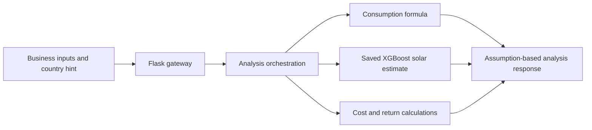

# SolarSense: my team integration work

I contributed consumption and integration work to a team prototype that calculates energy, solar-generation and assumption-based cost estimates for small businesses.

## The problem

The team wanted to turn business inputs into an inspectable solar-viability analysis. The implemented system is a local engineering prototype; predictive validity and financial usefulness for African businesses have not been established.

## What I built

My contribution covers consumption and integration corrections in the retained team history, plus updates to recommendation integration. This personal fork preserves other contributors' credit. The wider system includes a Flask gateway, consumption calculation, solar-generation model and cost/recommendation rules.

## Architecture



## How it works

The gateway routes requests to component Flask applications. Analysis calls sibling endpoints over local HTTP, combines their outputs and returns an estimate and recommendation. Consumption uses floor area, opening hours, refrigeration and city climate factors. Country hints select configured assumptions where coarse geographic boxes overlap; hints must match a supported box.

## ML / AI methodology

The consumption endpoint loads a historical Gradient Boosting model but **does not use its prediction for the returned value**. Its served output is a formula. The model card and changelog disagree on historical rows/scores, so those figures are not current predictive evidence.

Solar generation uses a saved XGBoost tree model with location and month features to estimate typical generation from historical climate data. Further scaling, lifetime degradation and country adjustments are assumptions. Historical training/validation was not rerun; no baseline or verified result establishes new-location predictive accuracy for the complete served analysis. Cost and recommendation components are arithmetic and rules. Their confidence scores are not calibrated probabilities.

## Engineering

HTTP endpoints, input validation, API-key checks, Flask routing and component tests exist. A repeatable smoke script starts a threaded local server, loads real artifacts, checks an analysis and shuts down. Rate limiting uses in-memory storage in this bounded local setup. An offline CI workflow is committed; no current hosted success is claimed.

## Results

On 13 October 2026, isolated Python 3.12 completed a fictional Nairobi example: **2700 kWh/month** from the consumption formula and **459 USD/month** in grid cost using the configured Kenya tariff. These are reproducible calculations, not observed savings or validated recommendations.

The active suite passed **211 tests**, including 14 country-selection checks, with 50 in-memory-limiter warnings. A missing API key returned **401**; ambiguous coordinates without a country hint returned **400**. Archived experiments and manual live-service scripts are separate from that active suite.

## Demo

The [corrected execution receipt](evidence/portfolio_smoke.json) records the fictional input, results, environment and artifact hashes. There is no verified live deployment or frontend in this repository. The earlier receipt selecting Tanzania for Nairobi is retained as defect evidence, not a valid recommendation.

## Run locally

The verified Windows Python 3.12 path is:

```powershell
python -m venv .venv
.\.venv\Scripts\python.exe -m pip install -r requirements.txt -r requirements-dev.txt
.\.venv\Scripts\python.exe scripts/portfolio_smoke.py --output evidence/portfolio_smoke.json
.\.venv\Scripts\python.exe -m pytest -q
```

The smoke script creates a temporary local key and does not contact a deployed service or external data provider. It writes a fresh receipt to the supplied path; use another filename to preserve the committed receipt. Manual server configuration is preserved in the [historical team README](docs/TEAM_README.historical.md), and is not the verified demo path above.

## Repository structure

- `api/`: gateway and routing.
- `models/`: active consumption, solar, cost and recommendation components alongside historical experiments.
- `scripts/portfolio_smoke.py`, `evidence/`: local execution and receipts.
- `tests/`, `pytest.ini`: active regression tests and collection scope.
- `docs/`, `CHANGELOG.md`: team design/history and attribution.

## Limitations

Coarse boxes do not establish political borders or tariff correctness. Consumption is not validated African ML prediction. Historical solar scores do not validate adjusted cost reports. Prices, climate multipliers, lifetime assumptions and recommendation thresholds need independent domain evaluation. ROI (return on investment) here is scenario arithmetic, not measured return. No adoption, savings or production-readiness claim is supported.

## What I would improve next

1. Resolve model-card/artifact provenance before presenting historical scores.
2. Validate energy estimates against independently observed local data.
3. Replace coarse country selection and static prices with verified inputs.

## My contribution

Commits `6bb92fb`, `4c3b058`, `35d35d7` and `fc29516` record my consumption/integration corrections under Tessa-Saumu. The recommendation module credits Bella as owner and me for updates. This personal fork retains team history; I do not claim sole authorship or all model training. The later AI-assisted portfolio cleanup removed machine-specific debug writes, repaired ambiguous country selection and added bounded execution evidence without retraining. The original team repository was not edited.
