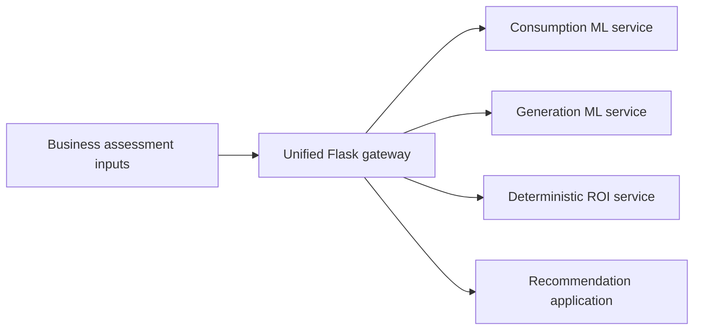
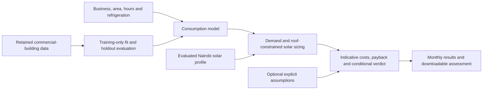

# SolarSense: Business Solar Viability Prototype

SolarSense connects electricity-demand estimates, solar-generation models and financial calculations into a usable solar viability assessment. I built and finalised both ML models and integrated them into the assessment system, taking everyday business inputs through to an inspectable report.

## The problem

A small business should not need to know its electricity consumption, panel size or installation cost before exploring solar. SolarSense starts with business type, location, premises and equipment, then estimates demand and an indicative solar option. It is a prototype; its estimates need local measurements and a site survey before investment.

## What I built

I built and finalised the consumption and generation models, integrated them into the Flask assessment system, and developed the interactive assessment with AI assistance. The workflow connects business, premises and equipment inputs to estimated demand, solar sizing, generation and indicative financial outputs.

In a timed prototype demonstration, the assessment took about **three minutes**. The original assessment process was reported to take **1–3 weeks**; this is prototype timing against reported process context, not a measured customer rollout.

The current browser assessment follows business details → location → premises → equipment → review → viability results. It runs the exported consumption model, estimates solar size, compares indicative grid/diesel costs and exports JSON, monthly CSV and a printable report. Users can start without knowing consumption, panel area, tariff or installation cost and inspect or adjust the explicit assumptions.

## Architecture

The original system uses a unified Flask gateway to route requests to independent consumption, generation, ROI and recommendation applications. ROI is a deterministic financial calculation, not a third trained ML model. [Gateway source](api/main.py) and [historical architecture and service contracts](docs/TEAM_README.historical.md) preserve that implementation.



The later portable assessment is a separate execution path: it runs exported consumption trees and assessment calculations in the browser, using an evaluated Nairobi generation profile. It does not call a deployed version of the Flask system. Its calculation flow is:



## How it works

Enter a business name/type, select Nairobi and power supply, estimate floor area and weekly opening hours, and list equipment counts/hours. Consumption prediction uses area, weekly hours, refrigeration count and a broad food-sales/service category. Appliance-specific hours also provide a separate wattage cross-check; they are not falsely described as independently learned features.

Predicted demand and an explicit roof-availability assumption determine a suggested system size. Nairobi solar profiles determine theoretical generation; monthly usable energy is capped by demand. Demonstration prices give an indicative cost comparison and simple payback. The browser executes the exported consumption trees for your inputs and the same assessment calculations as the Python API. No hosted Python backend, subscription, key or live weather service is needed for the portable browser app.

## ML / AI methodology

**Consumption:** The inherited model used `kwh_per_sqft = ELCNS / SQFT`, which leaks the target and cannot be supplied when consumption is unknown. Its formula fallback predates the portfolio changes. I retained the historical artifacts and added a separately named gradient-boosted model using only observable inputs. The notebook also used the wrong activity codes; the corrected US CBECS food-sales/service cohort contains 309 buildings: 247 training and 62 holdout records. Fixed seed, training-only preprocessing, no holdout tuning. A training-median electricity-per-area baseline is reported alongside the model. Refrigeration values are missing in 241 of the 309 source records. US building results do not validate Nairobi shops.

**Solar:** The inherited NASA POWER-labelled CSV contains 29,200 daily records from 20 cities, dated February 2022-February 2026. Original extraction receipts are unavailable. One hundred missing irradiance values marked `good` are dropped; 29,100 usable rows become 240 city/month means.

Target: monthly mean irradiance × 10 m² × 20% efficiency, giving **theoretical kWh/day rather than measured installation output**. Features are coordinates, absolute latitude, month and an inherited broad season flag.

Fifteen cities/180 rows train fixed-parameter XGBoost. Abidjan, Cape Town, Johannesburg, Lusaka and Nairobi are entirely held out: five cities/60 rows. The baseline averages each month across training cities only. Parameters are inherited and fixed; no fresh tuning, future-time holdout or all-city refit. Four holdout cities follow the inherited split; Nairobi was added before fitting.

## Engineering

Validated Python inputs reject unsupported geography, unknown fields, malformed JSON and invalid numbers. Runtime checks bind the model to its evaluation receipt and reject inconsistent metadata. Python/JavaScript parity checks cover both profiles and boundary cases. A real HTTP smoke starts and closes a local server with an ephemeral key required by legacy components; no key is stored or printed.

Pinned dependencies, pytest and browser tests support reproduction. Legacy authenticated routes remain separate from the flagship contract. Their in-memory limiter still warns; no production-security or green hosted-CI claim is made.

## Results

The delivered assessment turns everyday business inputs into a suggested solar option, monthly energy breakdown, indicative cost comparison and downloadable report. The timed prototype took about three minutes; the model evaluations below define how cautiously its estimates should be used.

MAPE means mean absolute percentage error; lower is better.

| Consumption: 62 held-out US buildings | MAPE |
|---|---:|
| Observable-input gradient-boosted consumption model | 63.05% |
| Training-only area-intensity baseline | **59.03%** |

The consumption model is real, but it loses to the area baseline and is not accurate enough for installation decisions. The demo includes that result, rather than repeating the old target-leaking scores.

| Solar derived target | XGBoost MAPE | Monthly baseline MAPE |
|---|---:|---:|
| Five held-out cities | 11.21% | 16.05% |
| Nairobi only | 12.53% | **8.43%** |

The Nairobi solar baseline remains the default. These are theoretical irradiance-derived labels, not observed PV production.

**250 active Python tests pass**, with 50 inherited limiter warnings. **12 browser calculation tests pass**, including all seven full assessment parity cases. The exported consumption ensemble matches scikit-learn predictions on all 62 holdout records. Five real local assessment HTTP checks pass. See [consumption evaluation](evidence/consumption_evaluation.json), [consumption model card](models/energy_consumption/MODEL1_CARD.md), [solar evaluation](evidence/solar_evaluation.json) and [assessment methodology](docs/assessment_methodology.md).

## Demo

[Try the public SolarSense assessment](https://tessa-solarsense.purple-tick-2127.chatgpt.site/). Complete the five steps with everyday business inputs, then inspect estimated consumption, suggested solar size, generation, indicative costs and conditional viability. Inputs stay in the browser.

Costs and sizing parameters are explicit demonstration assumptions, not current local quotations. The current public assessment is limited to Nairobi. The original Vercel MVP was rechecked anonymously on 15 October 2026: its five-step flow loaded, but assessment failed with a 120,000 ms timeout. It is not verified functional.

## Run locally

Verified with pinned Python 3.12 on Windows:

```powershell
python -m venv .venv
.\.venv\Scripts\python.exe -m pip install -r requirements.txt -r requirements-dev.txt
.\.venv\Scripts\python.exe scripts/evaluate_solar.py
.\.venv\Scripts\python.exe scripts/train_consumption_observable.py
.\.venv\Scripts\python.exe scripts/export_demo.py
.\.venv\Scripts\python.exe scripts/export_assessment.py
.\.venv\Scripts\python.exe scripts/scenario_smoke.py
.\.venv\Scripts\python.exe -m pytest -q
node --test web-demo/scenario.test.mjs web-demo/assessment.test.mjs
python -m http.server 8001 --directory web-demo
```

Open `http://localhost:8001`. Node.js 18+ is needed for browser tests. Evaluation recreates model/receipts; export recreates browser profiles. The smoke closes its server. Archived experiments remain outside explicit active pytest scope. [Historical gateway instructions](docs/TEAM_README.historical.md) retain the original setup.

## Repository structure

- `solar_scenario/`: calculations, artifact loading and API routes.
- `web-demo/`: assessment wizard, actual model inference, tests and exported evidence.
- `scripts/train_consumption_observable.py`, `export_assessment.py`: observable-input consumption training and browser export.
- `scripts/evaluate_solar.py`, `export_demo.py`, `scenario_smoke.py`: reproduction.
- `evidence/solar_*`, `models/solar_generation/models/flagship_*`: current evaluation and training-only artifact.
- `api/`, other `models/`: original gateway and service components.
- `tests/`, `docs/`: checks and methodology.

## Limitations

Exploratory prototype, not a validated energy or finance product. The consumption model is trained on US food buildings, has substantial held-out error and loses to a simple area baseline. No Nairobi load validation exists. The inherited consumption artifact leaks its target and its historic scores are retired for predictive claims; the legacy endpoint keeps its earlier formula behavior.

Solar targets are derived from irradiance. Monthly matching omits actual shading, orientation, hourly dispatch, grid outages, storage and export sales. Prices, available roof fraction and operating losses are assumptions; roof structure and suitability are not assessed. Payback excludes finance, tax, degradation and replacements. No measured savings, calibrated confidence, future-weather forecast or production readiness is claimed.

## What I would improve next

1. Validate against permitted measured Nairobi load and installation data.
2. Add a separately frozen future-time evaluation and uncertainty diagnostics.
3. Add verified tariffs and hourly matching before decision-grade financial claims.

## My contribution

I built and finalised both the consumption and generation models, substantially developing the work after team handoff, and integrated them into the assessment system. Original commits `6bb92fb`, `4c3b058`, `35d35d7` and `fc29516` also record consumption/integration work. Bella remains recommendation-module owner; I contributed updates. The later AI-assisted personal work adds evaluation, scenarios, the browser assessment and checks. Other team contributions and the original architecture remain preserved in this repository; building both ML models does not imply sole authorship of every component. This update changes only my personal portfolio repository.
