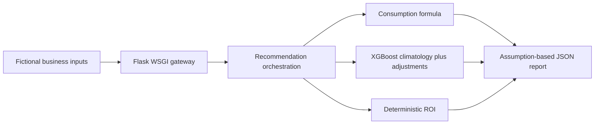

# SolarSense — team integration case study

A personal portfolio fork of a team Flask gateway combining consumption estimates, solar climatology, ROI calculations and rule-based recommendations.

**Status: bounded supporting engineering prototype.** Real local execution and active component tests reproduce; country/tariff selection now rejects ambiguity instead of guessing. This is an engineering prototype with unvalidated assumptions, not a financial recommendation or a validated African energy predictor.

## What this implementation actually does

- Consumption: the current endpoint uses floor-area/hours, refrigeration and climate formulas. It loads a Gradient Boosting artifact and encoders, but does not use the model's prediction for the returned consumption value.
- Solar: a saved XGBoost model returns a monthly climatology estimate, followed by deterministic area/lifetime scaling and country adjustments.
- ROI and recommendation: arithmetic, cost/tariff assumptions and rules. The confidence values are heuristics, not calibrated probabilities.



## My contribution and team boundaries

This fork preserves the team's history. Tessa-Saumu authored consumption and integration corrections visible in commits `6bb92fb`, `4c3b058`, `35d35d7` and `fc29516`. The recommendation module credits Bella as owner and Tessa for updates. Other contributors and their history are retained. These records support particular implementation/integration changes; they do not establish sole authorship of the complete system.

The October 2026 personal-fork consolidation removed machine-specific debug writes, cleaned ignore-file conflict markers, added a local execution receipt and narrowed claims. It did not retrain models or validate business outcomes.

## Run a local execution check

Verified on Python 3.12.0 with the committed pinned dependencies. From the repository root on Windows:

```powershell
python -m venv .venv
.\.venv\Scripts\python.exe -m pip install -r requirements.txt -r requirements-dev.txt
.\.venv\Scripts\python.exe scripts/portfolio_smoke.py --output evidence/portfolio_smoke.json
.\.venv\Scripts\python.exe -m pytest models/energy_consumption/tests models/solar_generation/tests models/roi_calculation/tests -q
```

The smoke script creates a temporary local key, starts a threaded loopback gateway, exercises `/analyze` with real artifacts and shuts down. It checks the consumption formula and rejection of a missing key. No provider or deployed service is contacted. A successful smoke result means execution mechanics passed, not that the recommendation is correct. The active unit command passes; archived experiments and manual live-service scripts are separate tiers. See the release audit for exact scope.

For manual execution, configure `API_KEY` and `MODELS_BASE_URL=http://127.0.0.1:8000/api/v1`, then run `python -m api.main`. Keep the server local and threaded because orchestration calls its sibling endpoints over HTTP. Gateway health alone does not prove dependency readiness.

## Verified results and important failures

On 2026-10-13, the pinned environment loaded both committed model artifacts and produced one complete fictional local analysis. The consumption formula gave 2700 kWh/month. The missing-key analysis request returned 401. [Execution receipt](evidence/portfolio_smoke.json) records the input, output, environment and artifact hashes.

The first Nairobi run was incorrectly resolved to Tanzania by overlapping geographic boxes. Its receipt is retained separately as defect evidence. The repaired route rejects ambiguous coordinates without an explicit `country` hint and accepts Kenya only within its configured coarse bounds. The corrected example verifies the configured Kenya tariff (459 monthly grid cost for 2700 kWh). A hint selects assumptions; it is not geospatial or tariff validation.

The first component run produced 161 passed/36 failed. After fixing malformed-input/type rejection and reconciling stale tests with the documented formula and response contract, the default active suite produced **211 passed**, including 14 country regressions, with 50 in-memory rate-limiter warnings. No failures were hidden with skips/xfails. Historical 195/197 evidence is not the current count.

Historical Model 1 cards and changelog disagree on training rows and scores. No Model 1 R2/MAPE is claimed for the served formula. Model 2 metadata contains a historical validation MAPE; that study was not retrained in this run and does not establish spatial generalization or the accuracy of adjusted end-to-end recommendations.

## Reviewable evidence and next steps

- [Gap audit](PORTFOLIO_GAP_AUDIT.md), [implementation plan](PORTFOLIO_IMPLEMENTATION_PLAN.md), [release audit](PORTFOLIO_RELEASE_AUDIT.md).
- [Historical team README](docs/TEAM_README.historical.md) retains the original setup and development record; it is not the current readiness claim.
- Next, only if promoting beyond this prototype: recover final model provenance and independently evaluate country, energy and financial assumptions. No frontend rebuild, deployment or new training campaign is needed to investigate those gates.

No current deployment, user adoption, measured savings, domain validation, calibrated confidence or production readiness is claimed.
