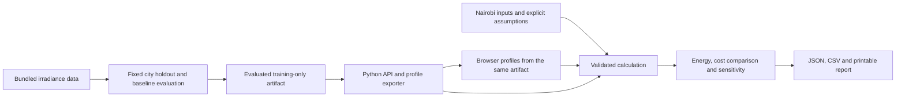
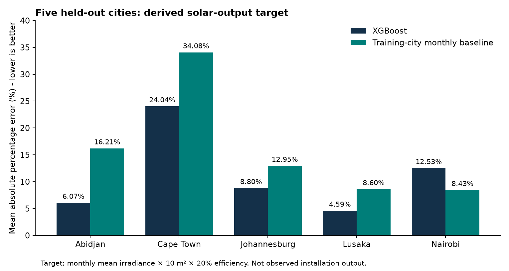

# SolarSense: Nairobi Energy Scenario Explorer

I extended a team solar prototype into a Nairobi scenario tool with explicit energy and cost assumptions, reproducible model evaluation and downloadable reports.

## The problem

A business considering solar needs to understand its estimated consumption, solar output, tariff and system costs. This project makes that calculation inspectable; it does not establish actual installation yield or customer savings.

## What I built

The personal extension adds a Nairobi/Kenya scenario API, browser calculator, formula or measured-consumption inputs, baseline/model comparison, tariff sensitivity and JSON/CSV/printable exports. I directed AI-assisted development and verification while preserving original team ownership.

## Architecture



## How it works

Choose an illustrative bakery, grocery or butchery profile and edit its load/hours, or enter measured monthly consumption. Set panel area, efficiency, the share used on site, tariff, installation cost and maintenance. Energy offset is capped by demand each month; exported electricity earns no payment.

The browser uses twelve exported Nairobi profiles from the same evaluated artifact and baseline as the Python API, then calculates visitor inputs locally. It does not call live weather or a hosted Python backend. The baseline defaults after its lower Nairobi error was observed; that comparison-driven choice is not a new independent validation result.

## ML / AI methodology

The inherited NASA POWER-labelled CSV contains 29,200 daily records from 20 cities, dated February 2022-February 2026. Original extraction receipts are unavailable. One hundred missing irradiance values marked `good` are dropped; 29,100 usable rows become 240 city/month means.

Target: monthly mean irradiance × 10 m² × 20% efficiency, giving **theoretical kWh/day rather than measured installation output**. Features are coordinates, absolute latitude, month and an inherited broad season flag.

Fifteen cities/180 rows train fixed-parameter XGBoost. Abidjan, Cape Town, Johannesburg, Lusaka and Nairobi are entirely held out: five cities/60 rows. The baseline averages each month across training cities only. Parameters are inherited and fixed; no fresh tuning, future-time holdout or all-city refit. Four holdout cities follow the inherited split; Nairobi was added before fitting.

## Engineering

Validated Python inputs reject unsupported geography, unknown fields, malformed JSON and invalid numbers. Runtime checks bind the model to its evaluation receipt and reject inconsistent metadata. Python/JavaScript parity checks cover both profiles and boundary cases. A real HTTP smoke starts and closes a local server with an ephemeral key required by legacy components; no key is stored or printed.

Pinned dependencies, pytest and browser tests support reproduction. Legacy authenticated routes remain separate from the flagship contract. Their in-memory limiter still warns; no production-security or green hosted-CI claim is made.

## Results

MAPE is mean absolute percentage error; lower is better. These errors concern the derived target.

| Evaluation | XGBoost MAPE | Monthly baseline MAPE |
|---|---:|---:|
| Five held-out cities | 11.21% | 16.05% |
| Nairobi only | 12.53% | **8.43%** |

Overall mean absolute error is 1.2442 versus 1.6306 kWh/day. The overall model advantage does not establish a Nairobi advantage. Cape Town model error is 24.04%.



**239 active Python tests pass**, with 50 inherited limiter warnings; **six browser tests pass**. Seven exported Python scenarios match JavaScript. Real HTTP checks cover evidence, both profiles, capped demand and out-of-scope rejection. Isolated retraining reproduced the model fingerprint. Exact results: [evaluation receipt](evidence/solar_evaluation.json), [model card](models/solar_generation/MODEL2_CARD.md).

## Demo

[Try the public Nairobi explorer](https://tessa-solarsense.purple-tick-2127.chatgpt.site/). No key required. Change inputs, compare profiles and download JSON, monthly CSV or a printable report. Inputs stay in the browser.

Defaults such as KES 25/kWh and KES 300,000 installation cost are fictional assumptions, not verified prices. The old 2,700 kWh/month team example remains historical execution evidence, not this scenario or an accuracy claim.

## Run locally

Verified with pinned Python 3.12 on Windows:

```powershell
python -m venv .venv
.\.venv\Scripts\python.exe -m pip install -r requirements.txt -r requirements-dev.txt
.\.venv\Scripts\python.exe scripts/evaluate_solar.py
.\.venv\Scripts\python.exe scripts/export_demo.py
.\.venv\Scripts\python.exe scripts/scenario_smoke.py
.\.venv\Scripts\python.exe -m pytest -q
node --test web-demo/scenario.test.mjs
python -m http.server 8001 --directory web-demo
```

Open `http://localhost:8001`. Node.js 18+ is needed for browser tests. Evaluation recreates model/receipts; export recreates browser profiles. The smoke closes its server. Archived experiments remain outside explicit active pytest scope. [Historical gateway instructions](docs/TEAM_README.historical.md) retain the original setup.

## Repository structure

- `solar_scenario/`: calculations, artifact loading and API routes.
- `web-demo/`: calculator, tests and exported evidence.
- `scripts/evaluate_solar.py`, `export_demo.py`, `scenario_smoke.py`: reproduction.
- `evidence/solar_*`, `models/solar_generation/models/flagship_*`: current evaluation and training-only artifact.
- `api/`, other `models/`: inherited team components.
- `tests/`, `docs/`: checks and methodology.

## Limitations

An engineering-led flagship prototype, not a validated energy/finance product. Consumption is arithmetic or user input. Solar targets are derived from irradiance; upstream extraction, measured installations and future periods are unverified. The baseline choice followed the Nairobi comparison.

Monthly matching is not hourly dispatch. Shading, orientation, inverter losses, storage, degradation, tax, fixed charges, financing and replacement costs are excluded. Simple payback is arithmetic, not measured return. No calibrated confidence is emitted. The legacy consumption model remains bypassed by a formula; its historical scores do not validate served consumption.

## What I would improve next

1. Validate against permitted measured Nairobi load and installation data.
2. Add a separately frozen future-time evaluation and uncertainty diagnostics.
3. Add verified tariffs and hourly matching before decision-grade financial claims.

## My contribution

Original commits `6bb92fb`, `4c3b058`, `35d35d7` and `fc29516` record consumption/integration corrections. Bella remains recommendation-module owner; I contributed updates. The new AI-assisted personal extension adds evaluation, scenarios, demo and checks. It does not turn inherited modules into sole-authored work. Only my personal fork changed; the team repository was not accessed or edited.
